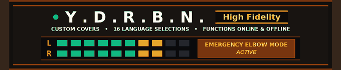

<div align="center">




# Y.D.R.B.N. — Your Daily Random Band Name

**Produced By: Monkey With A Hammer • Co-written By: Confused Canines • Full Of: Nonsense**

[](https://lharles.github.io/ydrbn-app/)<br>
[](./docs/USER_GUIDE.md)<br>
[](https://lharles.github.io/ydrbn-app/) [](https://lharles.github.io/ydrbn-app/) [](https://lharles.github.io/ydrbn-app/)

*Inspired by [“Random Band Names, Volume One”](https://duckduckgo.com/?t=ffab&q=Random+Band+Names+Charles+Key&ia=web) by [Charles Key](https://www.google.com/search?q=Random+Band+Names+Charles+Key)*
</div>


---

## ✨ Imitation Walnut Case &amp; Vacuum Tube Functionality

* **🎨 Album Cover Creation Studio:** Create unique, vintage-inspired album covers, with randomized backgrounds, quirky illustrations, unexpected objects, and playful typography. Elements randomized for each album. No two albums should be quite alike. Unless, of course, you've activated EMERGENCY ELBOW MODE.
* **🔊 Multi-Instrument &amp; Vocal Record Player:** Bring your albums to life with a randomized mix of 1970s, 1980s, and 1990s musical styles. Guitars, bass, drums, piano, saxophone, synthesizers, harmonica, whistling, humming, and beatboxing - who knows!?! Watch the stereo sound meters dance, and adjust playback speed just like an old-school record player.
* **🌐 16-Language International Record Collection:** Give your creations an international twist! Switch languages or duplicate and translate individual albums into 16 different languages, including English, Spanish/Español, French/Français, German/Deutsch, Japanese/日本語, Chinese/中文, Hindi/हिन्दी, Arabic/العربية, Klingon/tlhIngan Hol, and even Pig-Latin/Igpay Atinlay. Enjoy properly adapted wording, translated tour destinations, right-to-left language support, and matching video subtitles. No language barriers. Well, except possibly Klingon. ...because even fictional bands deserve international distribution.
* **🎞️ Digital Darkroom &amp; Custom Creation Studio:** Give any album cover a random, fresh look with a collection of classic photographic effects, such as Kodachrome, Cyanotype, Noir, and X-Ray. Some results may look better than others. Some may require an explanation. Artistic control is optional. Unexpected results are practically mandatory. Create your own custom records whenever inspiration strikes, and add unusual new words to the creative generator's vocabulary.
* **👕 Custom Apparel &amp; Tour Merchandise:** Turn your creations into print-ready merchandise. Make high-resolution, transparent-front T-shirt designs, full-size album artwork, and oversized tour-back designs featuring classic concert schedules, fictional destinations, orbital adventures, and wonderfully bizarre combinations. Look like you've attended a concert that never happened!
* **🧬 Share, Clone &amp; Expand Your Record Collection:** Share your musical masterpieces (or questionable decisions) with friends! Let College Radio Auto-Spin keep the music going, or head over to The Crate Forge to create your own custom collections -- Build your own expansion packs, assemble custom collections, and unleash obscene quantities of musical nonsense.
<details>

<summary><b>🌍 View All 16 Supported Languages &amp; Grammar Profiles (Click to Expand)</b></summary>
<br />

| Badge | Language | Native Name | Grammar &amp; Localization Engine |
| :--- | :--- | :--- | :--- |
| **EN** | English | English | A vocabulary of 740+ nouns, 310+ adjectives, and 210+ musical ensembles. That's a lot of ways to make questionable decisions. |
| **ES** | Spanish | Español | Concordancia de género entre sustantivos y adjetivos + salas de conciertos y subtítulos adaptados a cada región |
| **PT** | Portuguese | Português | Concordância de gênero entre substantivos e adjetivos + locais de shows e legendas adaptados a cada região |
| **FR** | French | Français | Accord des genres et des articles + salles de concert et sous-titres adaptés à chaque région |
| **IT** | Italian | Italiano | Uso degli articoli (`Il`/`Lo`/`L'`/`La`) e concordanza di genere + luoghi dei concerti localizzati |
| **DE** | German | Deutsch | Deutsche Wortbildung, zusammengesetzte Substantive und grammatische Beugungen + lokalisierte Konzertorte und Untertitel |
| **ID** | Indonesian | Bahasa Indonesia | Struktur bahasa Indonesia dengan pewatas setelah kata benda + lokasi konser yang disesuaikan secara lokal |
| **JA** | Japanese | 日本語 | 日本語の修飾語と名詞の語順に対応 + CJK文字組版と字幕 |
| **ZH** | Mandarin | 中文 | 符合中文名词结构与修饰语规则 + 中日韩文字排版及字幕 |
| **HI** | Hindi | हिन्दी | हिंदी व्याकरण और लिंग-संबंधी शब्द-सामंजस्य + देवनागरी लिपि और स्थानीयकृत संगीत कार्यक्रम स्थल |
| **BN** | Bengali | বাংলা | বাংলা ব্যাকরণ ও লিপির সমর্থন + স্থানীয় কনসার্টের স্থান এবং উপশিরোনাম |
| **UR** | Urdu | اردو | مکمل دائیں سے بائیں (RTL) نستعلیق/عربی طرز کی ترتیب + اردو قواعد اور مقامی کنسرٹ مقامات |
| **AR** | Arabic | العربية | دعم كامل للكتابة من اليمين إلى اليسار (RTL) + قواعد الإضافة العربية وأماكن الحفلات الموطّنة |
| **RU** | Russian | Русский | Славянская грамматика, согласование по падежам и родам, кириллица + локализованные концертные площадки и субтитры |
| **TLH** | Klingon | tlhIngan Hol | tlhIngan wo' qun, Qo'noS/Sto-Vo-Kor lengmeH Daqmey je tlhIngan Hol subtitles |
| **PIG** | Pig-Latin | Igpay Atinlay | Igpay Atinlay ordway ansformationtray, ithway acronymsyay and ADNay eservedray |

</details>

---

## 📲 Live App &amp; 100% Offline Installation

Launch in any browser: **[https://lharles.github.io/ydrbn-app/](https://lharles.github.io/ydrbn-app/)**

* **Android / Desktop (Chrome, Edge, Brave):** Click the pulsing **Install** icon in the top receiver bar (or inside System Settings) to mount the standalone offline deck.
* **iPhone / iPad (Safari):** Tap Safari's **Share** button and select **“Add to Home Screen”**.

## 🛠️ Local Development

```bash
git clone https://github.com/lharles/ydrbn-app.git
cd ydrbn-app
npm install --legacy-peer-deps
npm run dev
```

<div align="center">
  <sub><b>DO NOT FOLD, SPINDLE, OR MUTILATE Y.D.R.B.N.</b> • Contains 100% Air Guitar Friendly Content</sub>
</div>
